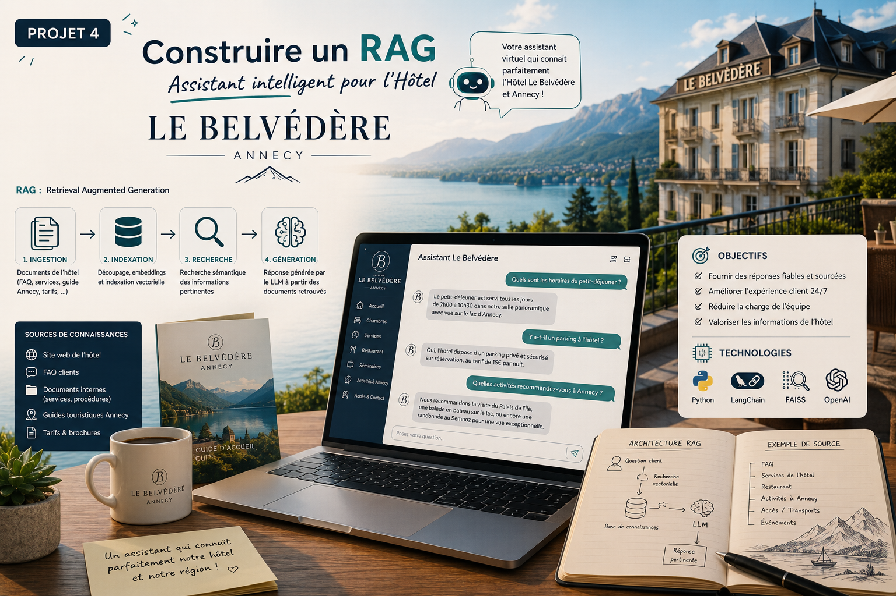
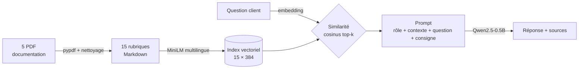

#  Assistant virtuel RAG — Hôtel Le Belvédère

   

<p align="center"></p>

Assistant conversationnel qui répond aux questions des clients d'un hôtel **uniquement à partir de sa documentation interne (PDF)**, **cite ses sources** et répond « je ne sais pas » lorsque l'information n'existe pas. Le pipeline fonctionne entièrement en local, avec des modèles open source.

---

## 🎯 Problématique

Un hôtel de 42 chambres à Annecy, en pleine saison, voit son équipe de réception réduite et submergée de questions répétitives (horaires, tarifs, spa, animaux, wifi…). Objectif : automatiser ces réponses **sans jamais inventer d'information** (tarif, service, horaire) qui engagerait l'établissement.

##  Démarche

Trois stratégies ont été implémentées et comparées sur le même jeu de test (3 questions couvertes par la documentation + 1 question hors périmètre) :

1. **LLM seul (baseline)** — le modèle répond avec ses seules connaissances.
2. **Contexte complet** — toute la documentation (~1 400 mots) est injectée dans chaque prompt.
3. **RAG** — recherche sémantique des 2 rubriques les plus pertinentes, seules injectées dans le prompt.

##  Architecture du pipeline RAG



| Étape | Choix technique |
|---|---|
| Ingestion | Extraction `pypdf`, suppression des pieds de page, 1 page = 1 chunk |
| Embeddings | `paraphrase-multilingual-MiniLM-L12-v2` (384 dim., adapté au français) |
| Recherche | Similarité cosinus (vecteurs normalisés, produit scalaire `numpy`) |
| Génération | `Qwen/Qwen2.5-0.5B-Instruct`, décodage déterministe |
| Garde-fou | Consigne de prompt imposant une réponse de repli fixe hors documentation |

## 📊 Résultats

| Stratégie | Questions factuelles correctes | Refus hors périmètre | Contexte envoyé | Temps (4 questions, CPU) |
|---|:---:|:---:|:---:|:---:|
| LLM seul | ❌ hallucinations (« 5 étoiles à Paris ») | — | 0 mot | — |
| Contexte complet | 1 / 3 | ✅ | 1 415 mots | 873 s |
| **RAG (top-2)** | **3 / 3** | ✅ | **≈ 210 mots** | **144 s** |

➡️ **Le RAG corrige toutes les erreurs, divise le temps de réponse par ~6 et la taille du contexte par ~7.**

Exemple de sortie :

```
Client   : A quelle heure commence le check-in ?
Sources  : Horaires de la réception (0.59), Politique d'annulation et de paiement (0.53)
Assistant: Le check-in commence à 15h.
--------------------------------------------------------------------------------
Client   : Est-ce que vous acceptez les paiements en Bitcoin ?
Sources  : Politique d'annulation et de paiement (0.27), Wifi et connexion internet (0.18)
Assistant: Je ne sais pas, je vous invite à contacter la réception.
```

**Enseignements clés**
- *Moins de contexte, meilleures réponses* : un contexte ciblé limite les distractions du modèle, le coût en tokens et la latence, quelle que soit la taille du corpus.
- *Traçabilité* : chaque réponse est accompagnée de ses sources et de leur score de similarité.
- *Détection du hors-périmètre* : les questions non couvertes obtiennent des scores nettement plus faibles (≈ 0,2 contre ≈ 0,6), utilisables comme seuil de rejet.

## Stack technique

`Python 3.13` · `transformers` · `sentence-transformers` · `torch` · `pypdf` · `numpy` · `pandas` · `scikit-learn` (t-SNE) · `matplotlib`

##  Installation et exécution

```bash
git clone https://github.com/ignasska11/rag-hotel-belvedere.git
cd rag-hotel-belvedere

# avec uv
uv sync            # ou : uv add -r requirements.txt
# ou avec pip
pip install -r requirements.txt

jupyter notebook rag_hotel_belvedere.ipynb
```

> Au premier lancement, les deux modèles (~1,5 Go) sont téléchargés depuis Hugging Face puis mis en cache.

##  Structure du projet

```
rag-hotel-belvedere/
├── rag_hotel_belvedere.ipynb   # notebook principal (pipeline complet + analyse)
├── utils.py                    # affichage formaté des échanges (question, sources, réponse)
├── data/                       # documentation PDF de l'hôtel (5 fichiers)
├── image.png                   # visuel du projet
├── requirements.txt
└── README.md
```

## ⚠️ Limites et perspectives

**Limites** : LLM de petite taille (0,5 B paramètres) parfois trop prudent lorsque la formulation diffère de la documentation ; jeu d'évaluation réduit (4 questions) ; chunking trivial adapté à des rubriques courtes.

**Pistes d'amélioration**
- Base vectorielle **FAISS / Chroma** et benchmark sur un corpus volumineux
- LLM plus performant (Qwen 7B, Mistral, API) et comparaison qualitative
- Chunking avec recouvrement pour des documents longs
- Évaluation quantitative : **recall@k** (retrieval) et **fidélité au contexte** (génération)
- Seuil de similarité pour rejeter les questions hors sujet avant l'appel au LLM
- Interface de chat **Gradio / Streamlit** avec mémoire conversationnelle

##  Compétences mobilisées

NLP · LLM · RAG · Embeddings et recherche sémantique · Prompt engineering · Extraction de données non structurées (PDF) · Évaluation comparative de modèles · Visualisation (t-SNE)

---

*Projet réalisé dans le cadre d'une formation en Machine Learning (Machine Learnia) ; l'hôtel et sa documentation sont fictifs.*
